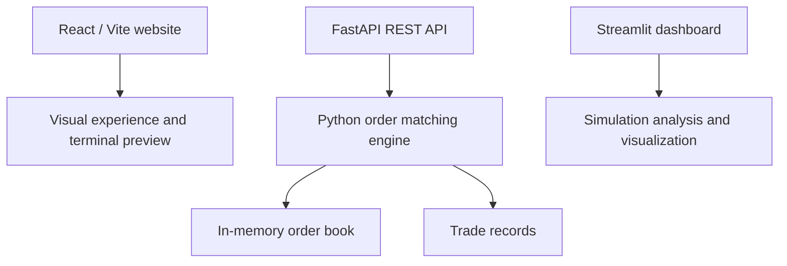
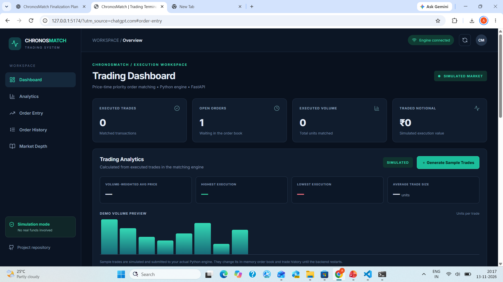
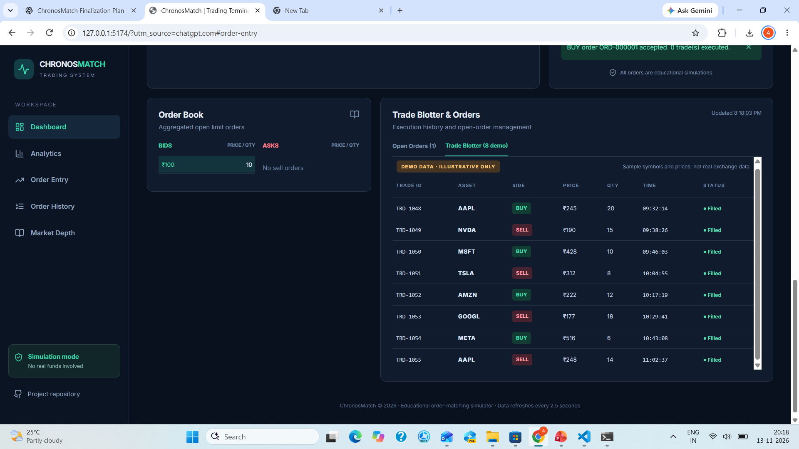

<div align="center">

# CHRONOSMATCH

### BEYOND THE ORDER.

**An educational high-frequency trading simulation built around price–time priority.**

    

**[Explore the code](https://github.com/aayuabcd/chronosmatch-hft-engine)** · **[API documentation](#rest-api)** · **[Run locally](#run-the-project)**

</div>

---

## The Experience


A burgundy-and-rose-gold React experience introducing the core ideas behind an order-matching engine. Animated 3D graphics and an editorial interface accompany a working Python simulation.


> **Simulation only:** ChronosMatch is an educational project. It does not connect to a live exchange or execute real financial transactions. The React terminal is currently a visual preview; the FastAPI backend is available separately.

## What It Does

- **Price–time priority:** better prices match first; orders at the same price follow FIFO order.
- **Limit order matching:** simulated BUY and SELL orders interact through an in-memory order book.
- **Partial fills and cancellations:** unfilled quantities can remain open until matched or cancelled.
- **Trade records:** executed matches can be inspected and analyzed.
- **REST endpoints:** FastAPI exposes order submission, order book, trade history, cancellation, and health checks.
- **Two interfaces:** a cinematic React website and a separate Streamlit dashboard.

## Architecture



**Current integration status:** The React frontend is not yet wired to the FastAPI endpoints. Run and demonstrate the API and React website separately.

## Technology

| Layer | Tools |
|---|---|
| Matching engine | Python, price–time priority, order-book data structures |
| API | FastAPI, Pydantic, Uvicorn |
| Frontend | React, Vite, JavaScript, CSS, Three.js / React Three Fiber |
| Visualization | Streamlit |
| Quality | pytest, Git, GitHub |

## REST API

| Method | Endpoint | Purpose |
|---|---|---|
| `GET` | `/health` | API health |
| `POST` | `/orders` | Submit simulated BUY or SELL order |
| `GET` | `/orderbook` | View order book and open orders |
| `GET` | `/trades` | View executed trades |
| `DELETE` | `/orders/{order_id}` | Cancel an open order |

Example order request:

```json
{
  "side": "BUY",
  "price": 100,
  "quantity": 10
}
```

Orders and trades are **in memory** and reset when the API process restarts.

## Run the Project

### 1. Clone and set up Python

```powershell
git clone https://github.com/aayuabcd/chronosmatch-hft-engine.git
cd chronosmatch-hft-engine
python -m venv .venv
.\.venv\Scripts\Activate.ps1
python -m pip install -r requirements.txt
python -m pip install fastapi uvicorn
```

### 2. Run the API

```powershell
python -m uvicorn api:app --host 127.0.0.1 --port 8765
```

Open **http://127.0.0.1:8765/docs** for interactive API documentation. Keep this terminal running.

### 3. Run the React website (new terminal)

```powershell
cd frontend
npm.cmd install
npm.cmd run dev
```

Open **http://localhost:5173/**. On macOS/Linux, use `npm` instead of `npm.cmd`.

### 4. Run the Streamlit dashboard (optional, from repository root)

```powershell
python -m streamlit run dashboard/app.py
```

## Quality Checks

```powershell
python -m pytest -q
cd frontend
npm.cmd run build
```

**Most recent locally reported verification (12 Nov 2026):** 19 Python tests passed; React production build succeeded. The frontend build reported a non-blocking large-bundle warning.

## Roadmap

- [x] Python order-matching engine
- [x] Automated matching-engine tests
- [x] Streamlit dashboard
- [x] Cinematic React experience
- [x] FastAPI endpoints
- [ ] Verify BUY/SELL API execution end to end
- [ ] Connect the React terminal to FastAPI
- [ ] Add live order-book and trade-history controls to the React UI

---

<div align="center">

**CHRONOSMATCH · BUILT TO EXPLORE THE LOGIC BEHIND EVERY MATCH**

Created by [Aayushi Suryawanshi](https://github.com/aayuabcd)

</div>

## Professional Trading Dashboard

A modern React trading terminal integrated with the ChronosMatch Python matching engine.

### Trading Dashboard & Analytics



### Trade Blotter & Order Book



